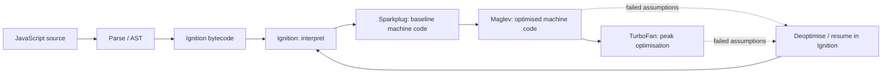

# 003 — JIT Compilation & V8

> **One-line takeaway:** V8 starts executing quickly, then spends more compilation effort
> where it may pay off. **Runtime feedback → specialised machine code → guarded assumptions
> → deoptimisation when those assumptions fail.**

---

## 1. Interpreted or Compiled? Both Can Apply

| Strategy | What happens | Tradeoff |
|---|---|---|
| **Interpretation** | An interpreter executes instructions, often bytecode rather than source text. | Low compilation cost, but instruction dispatch adds execution overhead. |
| **Ahead-of-time compilation (AOT)** | Code is compiled before execution. | More work up front; no live feedback from that particular execution. |
| **Just-in-time compilation (JIT)** | Code is compiled to machine code during execution. | Can use observed behaviour, but costs CPU, memory and warm-up time. |

**Compilation and interpretation are execution techniques, not exclusive language types.**
Compiling source to bytecode and then interpreting that bytecode uses both. JavaScript's
specification defines results, not a mandatory interpreter or JIT.

V8 is an **engine**, embedded by hosts such as Chrome and Node.js. It manages parsing,
execution and memory; the host supplies APIs and scheduling. Revisit the
[spec / engine / runtime distinction](004-javascript-vs-ecmascript-engines-and-runtimes.md#2-the-core-model-specification--engine--runtime)
if these terms blur together.

---

## 2. V8's Execution Tiers

The useful interview model is four tiers with increasing compilation investment.
The roles are documented in V8's [Sparkplug article](https://v8.dev/blog/sparkplug)
and [Maglev article](https://v8.dev/blog/maglev).



| Tier | Job | What to remember |
|---|---|---|
| **Ignition** | Bytecode interpreter | Starts execution without waiting for expensive optimisation; execution collects feedback. |
| **Sparkplug** | Fast, non-optimising baseline compiler | Compiles bytecode to machine code, avoiding interpreter dispatch with little compilation work. |
| **Maglev** | Fast optimising compiler | Uses feedback for useful specialisation at a lower compilation cost than the top tier. |
| **TurboFan** | Top optimising compiler | Invests more effort in hot code for peak execution performance. |

**Version context:** modern TurboFan uses **Turboshaft** compiler infrastructure; older
articles describe its Sea-of-Nodes design. This changes internals, not the tier's purpose.
See [V8's pipeline update](https://v8.dev/blog/leaving-the-sea-of-nodes).

> **The diagram is conceptual, not a compulsory ladder.** Functions can stay in lower
> tiers or skip tiers. Availability and decisions vary by V8 version, platform and flags;
> do not memorise a fixed “optimises after N calls” threshold.

Hotness includes repeated calls and loops. V8 can move an already-running loop into
optimised code using **on-stack replacement (OSR)**; it need not wait for the next call.
See [V8's tiering documentation](https://github.com/v8/v8/blob/main/docs/runtime/tiering.md).

---

## 3. Runtime Optimisation: Observe → Specialise → Guard

JavaScript allows a function to receive different types on different calls. The optimiser
doesn't need to prove that every future call has the same types; it can optimise for
observations **and check its assumptions**.

```js
function add(a, b) {
  return a + b;
}

add(1, 2);          // 3
add(3, 4);          // 7
// Imagine many numeric calls here: feedback may favour a numeric fast path.
add("hello", "!"); // "hello!" — concatenation must still work
```

**Conceptual fast path:** check numeric assumptions → use specialised arithmetic.
Those few calls do not guarantee optimisation or deoptimisation; the example explains
why guards are needed, not when a particular V8 build will tier up.

| Observed pattern | Possible optimisation |
|---|---|
| Stable operand types | Specialised arithmetic rather than a fully generic operation |
| Stable object shapes / layouts | Faster property access using known layouts |
| Predictable call targets | Inline a function body and optimise across the call |
| Proven redundant work | Eliminate repeated checks or calculations where valid |

V8's [Maglev design](https://v8.dev/blog/maglev) explains how feedback enables
specialisation; its [TurboFan resources](https://v8.dev/docs/turbofan) cover inlining and
other optimisations. The observable result must still follow ECMAScript.

---

## 4. Deoptimisation: Recover When Assumptions Fail

**Deoptimisation** exits specialised code when it is no longer safe to use. V8 retains
metadata to reconstruct execution state and resume in the interpreter, preserving the
program's behaviour. See [V8's deoptimisation documentation](https://chromium.googlesource.com/v8/v8/+/HEAD/docs/runtime/deoptimization.md).

```text
Many numeric calls → numeric specialisation + guards
New string inputs → guard may fail → reconstruct interpreter state
                  → execute the required concatenation semantics
                  → future feedback may support different optimisation
```

Potential triggers include unexpected types, object-layout changes or assumptions about
call targets becoming invalid. **A different type does not always cause a deopt**: the
existing code may already handle several cases or use a generic operation.

> **Deopt is not a crash or a restart of the whole program.** It trades performance for
> correctness at the affected execution point. Repeated optimise/deopt cycles can be
> costly, but occasional deopts are normal for speculative optimisation.

---

## 5. Interview & Performance Traps

| Claim | Better answer |
|---|---|
| **“JS executes source one line at a time.”** | Engines parse and compile; an interpreter can execute generated bytecode. |
| **“Every function eventually reaches TurboFan.”** | Compilation must be worthwhile; much code remains in lower tiers. |
| **“JIT makes JS statically typed.”** | Observed types guide guarded specialisation; language semantics remain dynamic. |
| **“Changing a type always deoptimises.”** | It depends on the generated code and its assumptions. |
| **“Fast microbenchmark = fast application.”** | Warm-up, constant folding, unused results and input patterns can distort tiny tests. |
| **“The event loop is a JIT tier.”** | Scheduling and compilation solve different problems; faster code can still block its thread. |

**Practical takeaway:** start with clear code and sound algorithms. Profile realistic
inputs; distinguish startup from sustained throughput. Consider allocation/GC and I/O
as well as execution time. Investigate unstable hot paths when measurements justify it;
do not contort ordinary code around guessed optimiser thresholds.

---

## 6. Quick Recall — Interview One-Liners

| Question | Crisp answer |
|---|---|
| **Is JS interpreted or compiled?** | The language doesn't mandate either; modern engines commonly interpret bytecode and JIT-compile machine code. |
| **Why multiple tiers?** | Balance startup cost, compilation work, memory and execution speed. |
| **Ignition?** | V8's bytecode interpreter. |
| **Sparkplug?** | Fast baseline compiler from bytecode to machine code, without heavy optimisation. |
| **Maglev?** | Fast optimising middle tier between baseline compilation and TurboFan. |
| **TurboFan?** | Top tier that spends more compilation effort on peak performance. |
| **Why runtime feedback?** | Observed types, shapes and call targets enable guarded specialisation. |
| **What is deoptimisation?** | Exit invalid specialised code, reconstruct state and resume safely in the interpreter. |
| **What is OSR?** | Switch an executing function/loop into optimised code without waiting for a fresh call. |
| **Does every function follow all tiers?** | No; tiering is heuristic and depends on engine configuration and workload. |
